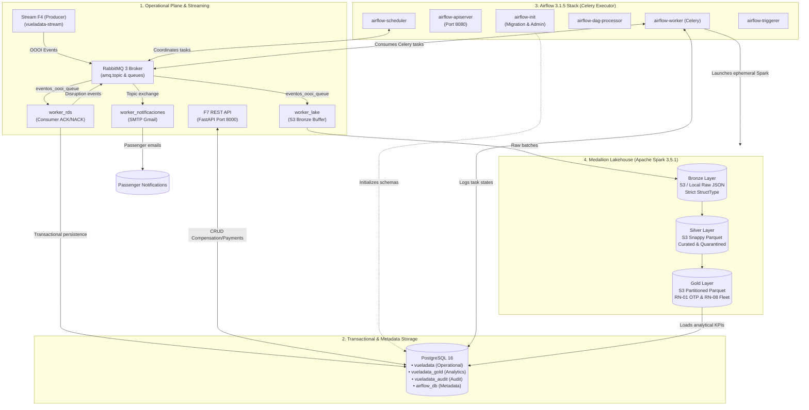
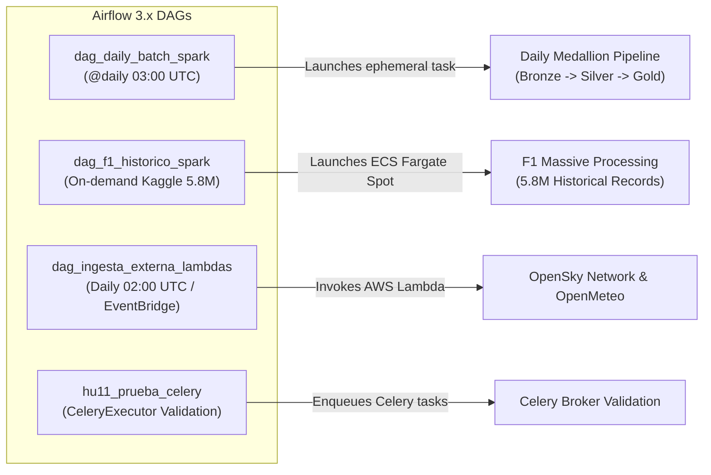
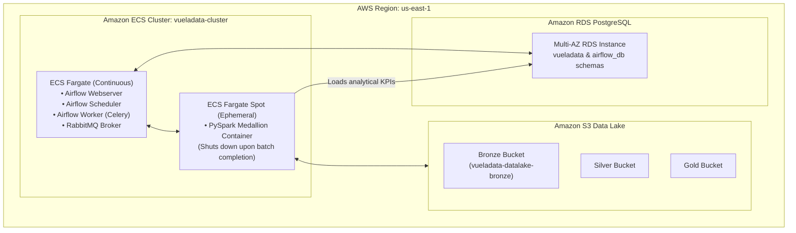

# Platform Orchestration and Unified Deployment — VuelaData

The **`vueladata-orchestration`** repository is the **operational core and master launchpad for the entire VuelaData ecosystem**. From this component, the complete platform is configured, orchestrated, and launched, integrating the relational database, message broker, analytical workflows powered by **Apache Airflow 3.1.5**, distributed data processing using **Apache Spark 3.5.1**, and all operational microservices and telemetry producers.

> [!IMPORTANT]
> **Master Project Launchpad:**
> The entire platform (PostgreSQL relational database, RabbitMQ message broker, F7 REST API, background workers, F4 stream simulator, and the full Airflow 3 analytics stack) is started in a centralized and unified way from this repository with a single command:
> ```bash
> docker compose up -d --build
> ```

---

## 🏗️ End-to-End System Architecture

The architecture decouples the operational transactional plane from the big data analytical plane, interlinking all services across the isolated Docker virtual network `vueladata_net`:



---

## 🚀 Step-by-Step Global Startup Guide

### 1. Recommended Sibling Directory Structure

To ensure that relative build contexts in `docker-compose.yml` resolve properly, clone all project repositories as siblings within a shared parent directory:

```text
workspace-vueladata/
├── vueladata-orchestration/    # Master orchestration repository (LAUNCHPAD)
├── vueladata-api/              # F7 API source code and background workers
├── vueladata-stream/           # F4 OOOI telemetry stream producer
└── vueladata-database/         # PostgreSQL DDL initialization scripts
```

### 2. Configure Environment Variables

Inside the `vueladata-orchestration` directory, copy the master environment variables template:

```bash
cp .env.example .env
```

Review and adjust `.env` parameters as needed. Key default configuration values include:

```env
# Airflow Custom Base Image
AIRFLOW_IMAGE_NAME=vueladata/airflow:3.1.5

# Shared PostgreSQL Instance
POSTGRES_USER=postgres
POSTGRES_PASSWORD=postgres
POSTGRES_DB=vueladata
POSTGRES_PORT=5432

# RabbitMQ Broker & Celery Configuration
RABBITMQ_USER=rabbit_admin
RABBITMQ_PASSWORD=VuelaData_Rabbit2026!
RABBITMQ_PORT=5672

# Airflow 3 Cryptographic Security & Admin User
AIRFLOW_UID=50000
AIRFLOW_FERNET_KEY=dkoSW-HnalABxFeXIgKL4b0-SmnDocwv5cxBXjmj36Y=
AIRFLOW_ADMIN_USERNAME=admin
AIRFLOW_ADMIN_PASSWORD=admin_local_2026

# Email Dispatcher Settings
SMTP_HOST=smtp.gmail.com
SMTP_PORT=587
SMTP_USUARIO=your_account@gmail.com
SMTP_CLAVE=your_app_password
EMAIL_DESTINO_PRUEBAS=your_account@gmail.com
```

### 3. Launch the Complete Platform

Execute the master build and startup command in detached mode:

```bash
docker compose up -d --build
```

The automated startup sequence executes in strict dependency order:
1. **PostgreSQL** starts and runs schema initialization DDLs (`init-db.sql`, `02-schema.sql`, and creates `airflow_db`).
2. **RabbitMQ** starts and waits until its diagnostic health check ping reports healthy.
3. The ephemeral container **`airflow-init`** runs `airflow db migrate` and provisions the administrator user `admin`.
4. Airflow 3 core daemons launch in parallel (`apiserver`, `scheduler`, `dag-processor`, `worker`, `triggerer`).
5. **API F7**, background workers (`worker-rds`, `worker-lake`, `worker-notificaciones`), and the telemetry producer (`stream-producer`) build and start.

---

## 🌐 Control Panel and Service URLs

Once the containers are healthy, access the following web interfaces in your browser:

| Service | Local URL | Default Credentials | Description |
|---|---|---|---|
| **Airflow 3 UI** | [http://localhost:8080](http://localhost:8080) | `admin` / `admin_local_2026` | DAG workflow orchestration and Celery task monitoring |
| **F7 REST API (Swagger)** | [http://localhost:8000/docs](http://localhost:8000/docs) | N/A (Public) | Interactive OpenAPI documentation for operational endpoints |
| **RabbitMQ Management** | [http://localhost:15672](http://localhost:15672) | `rabbit_admin` / `VuelaData_Rabbit2026!` | AMQP broker management, exchange topology, and queue rates |
| **PostgreSQL** | `localhost:5432` (or `5433`) | `postgres` / `postgres` | Relational database (`vueladata`, `vueladata_gold`, `airflow_db`) |
| **API Healthcheck** | [http://localhost:8000/health](http://localhost:8000/health) | N/A | Container operational status endpoint |
| **API DB Healthcheck** | [http://localhost:8000/health/db](http://localhost:8000/health/db) | N/A | Active PostgreSQL connectivity verification |

---

## 📦 Container Catalog and Service Layering

The master `docker-compose.yml` file manages **11 active containers** structured into three decoupled layers:

### 1. Base Infrastructure Layer
- **`vueladata-postgres` (`postgres:16`):**
  - Primary relational engine.
  - Houses the `vueladata` operational schema, `vueladata_gold` analytics schema, `vueladata_audit` table, and `airflow_db` metadata database.
  - Includes automated health check via `pg_isready`.
- **`vueladata-rabbitmq` (`rabbitmq:3-management`):**
  - Central AMQP message broker.
  - Serves as the task queue broker for Airflow's **CeleryExecutor** and message highway for OOOI telemetry and passenger notification routing.

### 2. Apache Airflow 3.1.5 Stack
- **`airflow-init`:** Ephemeral initialization container running database migrations and admin user provisioning.
- **`airflow-apiserver`:** Execution API server and web UI for Airflow 3 exposed on port `8080`.
- **`airflow-scheduler`:** Core scheduling engine parsing task dependencies and queueing jobs.
- **`airflow-dag-processor`:** Dedicated daemon continuously compiling DAG definitions in an isolated sandbox.
- **`airflow-worker`:** Distributed Celery worker pulling and executing task instances from RabbitMQ.
- **`airflow-triggerer`:** Asynchronous event-loop engine for deferrable operators.

### 3. Operational Microservices and Producers
- **`vueladata-api`:** FastAPI REST service handling compensation claims, causes, and payments (port `8000`).
- **`vueladata-worker-rds`:** AMQP consumer with `ACK`/`NACK` logic persisting flight disruptions to PostgreSQL.
- **`vueladata-worker-lake`:** Batch consumer buffering telemetry messages and writing raw records to the Bronze Data Lake.
- **`vueladata-worker-notificaciones`:** Event-driven email dispatcher alerting passengers of cancellations and severe delays via Gmail SMTP.
- **`vueladata-stream-f4`:** Synthetic OOOI telemetry producer (100 flights) with controlled chaos injection.

---

## 🔄 Workflow Orchestration: Airflow 3.x DAGs

Analytical pipelines reside in the `dags/` directory and leverage Airflow 3's modern **TaskFlow API**:



### DAG Descriptions

1. **`dag_daily_batch_spark.py` (Daily Medallion Batch):**
   - **Schedule:** Daily at 03:00 AM UTC (`@daily`).
   - **Execution Flow:**
     1. `validar_entorno`: Verifies S3 bucket connectivity and AWS IAM credentials.
     2. `spark_medallion_fargate_spot`: Launches an ephemeral Apache Spark container in AWS ECS Fargate Spot running the Medallion pipeline (Bronze $\rightarrow$ Silver $\rightarrow$ Gold).
     3. `consolidar_auditoria`: Consolidates data quality metrics and record counts into `vueladata_audit`.
2. **`dag_f1_historico_spark.py` (Historical Kaggle 5.8M Flight Ingestion - HU-26):**
   - **Schedule:** `schedule=None` (Manual trigger / On-demand).
   - **Purpose:** Ingests the 5.8 million historical flight dataset from Kaggle (Source F1) stored in `s3://.../bronze/f1_kaggle/`, transforming raw schemas into standardized formats and calculating on-time performance (**RN-01**) and delay propagation (**RN-08**).
3. **`dag_ingesta_externa_lambdas.py` (External Ingestion and Audit):**
   - **Schedule:** Daily at 02:00 AM UTC or on demand.
   - **Purpose:** Audits and coordinates serverless AWS Lambda functions fetching external data from **OpenSky Network** (flight telemetry) and **OpenMeteo** (weather metrics), ensuring raw data is staged in Bronze prior to the daily Spark job.
4. **`hu11_prueba_celery.py` (CeleryExecutor Validation):**
   - Stress-testing DAG validating bidirectional communication between Airflow schedulers, RabbitMQ brokers, and distributed Celery workers.

---

## 🏅 Medallion Lakehouse Engine with Apache Spark 3.5.1

Big data processing adheres to **Clean Architecture** and the **Medallion Lakehouse** design pattern, isolating responsibilities through the Single Responsibility Principle (SRP):

```text
vueladata_etl/
├── core/
│   ├── config.py              # SparkSession factory configured with S3A Hadoop connectors
│   ├── constants.py           # Core business constants (OTP <= 15m, Turnaround 45m / 60m)
│   └── schemas/               # Explicit StructType schemas with zero inferSchema
│       ├── f1_schemas.py      # Flights, airlines, and airport schemas
│       ├── f6_schemas.py      # Fleet rotation and itinerary schemas
│       └── event_schemas.py   # OOOI telemetry and payment event schemas
└── pipeline/
    ├── bronze/                # BRONZE LAYER: Strict schema ingestion
    ├── silver/                # SILVER LAYER: Cleaning, deduplication, and quarantine
    └── gold/                  # GOLD LAYER: Business rules engine and KPI aggregations
```

### Medallion Layer Responsibilities

```mermaid
flowchart LR
    subgraph Bronze["1. Bronze Layer (Raw)"]
        B1["Strict StructType schema parsing"]
        B2["inferSchema = False\n(Optimized memory footprint)"]
        B3["Raw JSON / CSV files"]
    end

    subgraph Silver["2. Silver Layer (Curated)"]
        S1["Column standardization\n(English -> Spanish)"]
        S2["TimestampType casting"]
        S3["Idempotent UUID deduplication"]
        S4["Quarantine Filtering (Chaos)\n(Persisted to Snappy Parquet)"]
    end

    subgraph Gold["3. Gold Layer (Business & KPIs)"]
        G1["RN-01 Rule: On-time arrival OTP <= 15 min"]
        G2["RN-08 Rule: Propagation domino effect\n(Turnaround: 45m dom / 60m int)"]
        G3["Fleet and disruption aggregations"]
        G4["Partitioned Parquet & PostgreSQL load"]
    end

    Bronze --> Silver --> Gold
```



1. **Bronze Layer (`pipeline/bronze/`):**
   - Typed ingestion from `s3a://.../bronze/` applying explicit `StructType` schemas.
   - **Strict prohibition of schema inference (`inferSchema=False`)** to eliminate memory bottlenecks and speed up ingestion.
2. **Silver Layer (`pipeline/silver/`):**
   - Normalization and translation of column names (e.g., mapping Kaggle English terms to VuelaData conventions).
   - Strict datetime conversion to `TimestampType` with UTC validation.
   - Idempotent deduplication based on unique event identifiers (`id_externo_evento`).
   - Detection of temporal anomalies and corrupted cause codes (from F4 chaos injection), routing unrecoverable records to quarantine.
   - Curated output persisted to `s3a://.../silver/` in Snappy-compressed Parquet format.
3. **Gold Layer (`pipeline/gold/`):**
   - **RN-01 Rule (On-Time Performance - OTP):** Evaluates arrival delays $\le 15$ minutes across all operated commercial flights.
   - **RN-08 Rule (Delay Propagation and Knock-on Effect):** Tracks aircraft tail rotations and subtracts minimum airport turnaround windows (45 minutes for domestic flights, 60 minutes for international flights) to isolate root causes of propagated delays.
   - Persists aggregated KPIs to `s3a://.../gold/` and synchronizes metrics into PostgreSQL's `vueladata_gold` schema for BI dashboards.

---

## ☁️ AWS Cloud Production Architecture

In production, the platform deploys on **Amazon Web Services (AWS)** using cost-effective serverless and container services:



### Infrastructure as Code (IaC) Components

- **ECS Task Definitions (`infrastructure/aws/ecs/`):**
  - `task-airflow-webserver.json`: Web interface service.
  - `task-airflow-scheduler.json`: Scheduling engine service.
  - `task-airflow-worker.json`: Celery worker service.
  - `task-rabbitmq.json`: Dedicated RabbitMQ message broker.
  - `task-spark-spot.json`: Ephemeral Spark container running on **Fargate Spot** (up to 70% cost savings).
- **IAM Security Policies (`infrastructure/aws/iam/`):**
  - `policy-airflow-task.json`: Permissions for task queueing and ECS RunTask execution.
  - `policy-spark-task.json`: Least-privilege permissions for S3 Lakehouse read/write and RDS connections.
- **Automation Scripts (`infrastructure/aws/scripts/`):**
  - `build_and_push_ecr.ps1` / `.sh`: Automated image build and push to Amazon ECR.
  - `deploy_ecs_services.ps1`: ECS service deployment and rollout management.
  - `upload_bronze_datasets.ps1` / `.sh`: Batch dataset upload to the S3 Bronze bucket.

---

## 🛠️ Operational and Diagnostic Commands

### Inspect Service Status
```bash
docker compose ps
```

### View Live Logs for a Specific Service
```bash
# Airflow Scheduler logs
docker compose logs -f airflow-scheduler

# F7 REST API logs
docker compose logs -f vueladata-api

# Transactional RDS Worker logs
docker compose logs -f worker-rds

# OOOI Telemetry Producer logs
docker compose logs -f stream-producer
```

### Restart a Specific Component
```bash
docker compose restart vueladata-api
```

### Stop All Containers
```bash
docker compose down
```

### Full Teardown and Volume Reset
```bash
docker compose down -v
```
