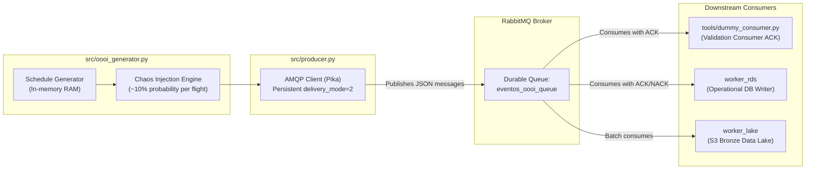
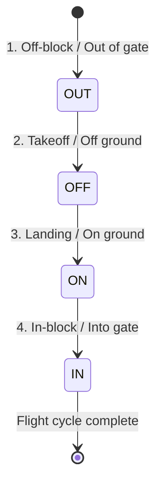
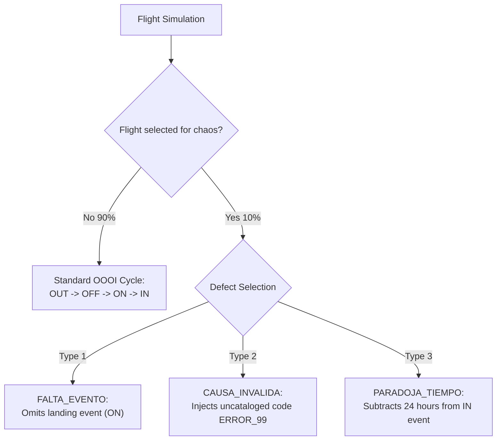

# F4 Stream Simulator (OOOI Events) — VuelaData

This module serves as the **Asynchronous Event Producer (Source F4)** for the VuelaData platform. Its primary role is to simulate the real-time operational lifecycle of commercial flights through standard aeronautical **OOOI** phases (*Out of gate*, *Off ground*, *On ground*, *Into gate*) and persistently transmit them through a RabbitMQ message broker.

The simulation is finite, isolated, and in-memory: the producer generates a schedule of `TOTAL_VUELOS` flights directly in RAM (with zero database dependency), publishes each sequential event to a durable queue, and terminates gracefully.

Additionally, the component embeds a controlled **Chaos Engineering engine (~10% anomaly injection)** designed to rigorously test downstream consumer resilience, data quality validations, and quarantine filters across REST services and Apache Spark Medallion ETL pipelines.

> [!NOTE]
> Multi-container orchestration for RabbitMQ and the `stream_f4` producer service is managed centrally from the `docker-compose.yml` file in the **`vueladata-orchestration`** repository.

---

## 🏗️ Microservice Producer Architecture

To ensure test isolation and eliminate database dependencies, this module executes entirely in memory:



### Internal Module Components

- **Data Generator (`src/oooi_generator.py`):** Aeronautical calculation engine. Builds a synthetic flight schedule using UTC timestamps, calculating realistic taxi-out, takeoff, flight duration, and taxi-in intervals.
- **AMQP Producer (`src/producer.py`):** Messaging client that serializes flight event dictionaries into JSON payloads, applies persistent delivery headers (`delivery_mode=2`), and publishes them to the durable `eventos_oooi_queue`. Includes an automatic retry mechanism of up to 10 attempts with a 3-second delay.
- **RabbitMQ Message Broker:** RabbitMQ container (`rabbitmq:3-management`) exposing port `5672` (AMQP protocol) and `15672` (web administration UI).
- **Validation Consumer (`tools/dummy_consumer.py`):** Audit and testing tool that subscribes to the queue, outputs received messages to console, and sends explicit acknowledgements (`ACK`) to confirm delivery.

---

## ⏱️ The OOOI Flight Lifecycle

Every simulated flight progresses through four sequential aeronautical phases in strict chronological order:



1. **OUT (Off-block / Departure from gate):** Calculated from scheduled departure time with an operational variance between `-10` and `+45` minutes.
2. **OFF (Takeoff / Off ground):** Generated `10` to `20` minutes after `OUT`, representing airport taxi-out time to the runway.
3. **ON (Landing / On ground):** Generated `40` to `180` minutes after `OFF`, representing actual cruise flight time based on distance.
4. **IN (In-block / Arrival at gate):** Generated `5` to `15` minutes after `ON`, simulating taxi-in time from the runway to the arrival gate.

---

## 📋 Data Contract (JSON Payload)

Every message dispatched to RabbitMQ adheres to a strict JSON schema with persistent storage enabled (`delivery_mode=2`):

```json
{
  "id_externo_evento": "6afabb29-e37a-4bdd-83d9-6c3318edad7b",
  "id_vuelo": 1,
  "numero_vuelo": "VU-1001",
  "codigo_evento": "OUT",
  "fecha_hora_evento_utc": "2026-10-22T06:24:27.505964+00:00",
  "codigo_causa_original": "TECNICA"
}
```

### Attribute Reference

| Field | Type | Required | Description |
|---|---|:---:|---|
| `id_externo_evento` | `UUID v4` | Yes | Globally unique event identifier generated by aircraft telemetry sensors. Used for idempotent deduplication. |
| `id_vuelo` | `Integer` | Yes | Foreign key referencing the flight segment in the transactional catalog. |
| `numero_vuelo` | `String` | Yes | Commercial flight designator (e.g., `VU-1001`). |
| `codigo_evento` | `String` | Yes | Aeronautical OOOI operational stage: `OUT`, `OFF`, `ON`, or `IN`. |
| `fecha_hora_evento_utc` | `String (ISO 8601)` | Yes | High-precision timestamp with explicit UTC offset (`+00:00`). |
| `codigo_causa_original` | `String` / `null` | No | If the `OUT` event is delayed by more than 15 minutes, records the disruption cause (`TECNICA`, `CLIMA`, etc.). Otherwise emits `null`. |

---

## 💥 Chaos Engineering and Controlled Defect Injection (HU-06 / HU-05)

To evaluate data cleansing rules and quarantine routing in the Spark Silver layer, the generator injects anomalies probabilistically: **each flight has a 10% chance (`probability = 0.1`) of defect injection**.



### Injected Defect Typology

1. **Missing Event (`FALTA_EVENTO`):** Simulates telemetry sensor dropout or signal loss. The aircraft reports `OUT`, `OFF`, and `IN`, but the landing event `ON` is never emitted. The downstream Silver layer must identify the gap.
2. **Invalid Cause (`CAUSA_INVALIDA`):** Substitutes a valid delay cause code with an uncataloged value (`ERROR_99`) on the `OUT` event. Tests relational foreign key enforcement and data validation rules.
3. **Time Paradox (`PARADOJA_TIEMPO`):** Simulates an incorrect midnight timezone rollover by subtracting exactly 24 hours from the `IN` event timestamp. Consequently, gate arrival precedes takeoff, triggering analytical quarantine logic.

---

## 🚀 Docker Deployment (HU-20 and HU-21)

Running the producer container alongside RabbitMQ on the isolated `vueladata_net` network is performed directly from the central **`vueladata-orchestration`** repository.

### 1. Producer Environment Variables

Initialize your local configuration from `.env.example`:

```bash
cp .env.example .env
```

| Variable | Value in `.env.example` | Default Fallback | Description |
|---|---|---|---|
| `RABBITMQ_HOST` | `rabbitmq` | `localhost` | Broker host (`rabbitmq` within Docker; `localhost` for native local scripts). |
| `RABBITMQ_PORT` | `5672` | `5672` | AMQP port. |
| `RABBITMQ_USER` | `rabbit_admin` | `admin` | Broker administrator username. |
| `RABBITMQ_PASS` | `VuelaData_Rabbit2026!` | `admin123` | Broker password. |
| `QUEUE_NAME` | `eventos_oooi_queue` | `eventos_oooi_queue` | Destination durable queue. |
| `STREAM_DELAY_SECONDS` | `1` | `1` | Pause between published messages in seconds (`0` enables burst mode). |
| `TOTAL_VUELOS` | `100` | `100` | Total flights simulated in the synthetic agenda. |

### 2. Multi-Container Startup

From the root of **`vueladata-orchestration`**:

```bash
docker compose up -d --build
```

The `stream-producer` container waits for RabbitMQ to pass its health check (`condition: service_healthy`) before initiating transmission.

### 3. Monitoring Live Transmission

Stream container logs in real time:

```bash
docker compose logs -f stream-producer
```

> [!NOTE]
> With default settings (`TOTAL_VUELOS=100`), the producer dispatches approximately **400 events** (1 message per second, less omitted `ON` events). Upon agenda completion, it prints total metrics and exits cleanly with return code `0`.

### 4. RabbitMQ Management Console

Monitor active throughput:
- **URL:** [http://localhost:15672](http://localhost:15672)
- **Username:** `rabbit_admin`
- **Password:** `VuelaData_Rabbit2026!`
- **Queue:** `eventos_oooi_queue` (view message ingress rate, unacknowledged counters, and payload graphs).

---

## 🛠️ Local Execution for Development and Auditing

To debug the producer and consumer in standalone terminals without running all Docker containers:

### 1. Start RabbitMQ Broker Only
From `vueladata-orchestration`:
```bash
docker compose up -d rabbitmq
```

### 2. Install Python Dependencies
In the `vueladata-stream` directory:
```bash
pip install -r requirements.txt
```

### 3. Configure Local Connection
In your local `.env`:
```env
RABBITMQ_HOST=localhost
RABBITMQ_PORT=5672
RABBITMQ_USER=rabbit_admin
RABBITMQ_PASS=VuelaData_Rabbit2026!
QUEUE_NAME=eventos_oooi_queue
```

### 4. Start Validation Consumer (Terminal 1)
```bash
python tools/dummy_consumer.py
```
The consumer waits for incoming events, validates payload syntax, prints the event to console, and returns `basic_ack`.

### 5. Start Event Producer (Terminal 2)
```bash
python src/producer.py
```
Dispatches the sequential OOOI flight events.

---

## 📦 Docker Optimization Evidence (HU-20)

To fulfill the acceptance criteria for **User Story HU-20**, the producer Docker image was optimized:

| Metric / Parameter | Standard Setup (Before) | Optimized Setup (Now) | Achieved Benefit |
|---|---|---|---|
| **Base Image** | `python:3.12` (~1.02 GB) | `python:3.12-slim` (~140 MB) | ~85% base disk footprint reduction |
| **Build Context** | No `.dockerignore` (copied node, docs, caches) | Strict `.dockerignore` | Context reduced from >150 MB to less than 1 MB |
| **Final Image Size** | ~1.15 GB | **~165 MB** | Ultra-fast image pulls in CI/CD pipelines |
| **Runtime User** | `root` (security risk) | `appuser` (UID 1000, non-root) | Principle of least privilege compliance |
| **Layer Caching** | `COPY . .` before requirements | Isolated `COPY requirements.txt` | Near-instant incremental rebuilds |

### AWS ECS Fargate Deployment (CI/CD)

The optimized image is published to Amazon ECR under `vueladata/stream-producer` and executed as an AWS ECS Fargate task through GitHub Actions (`.github/workflows/deploy.yml`), utilizing `task-definition-stream-producer.json` and credentials stored in AWS SSM Parameter Store.
